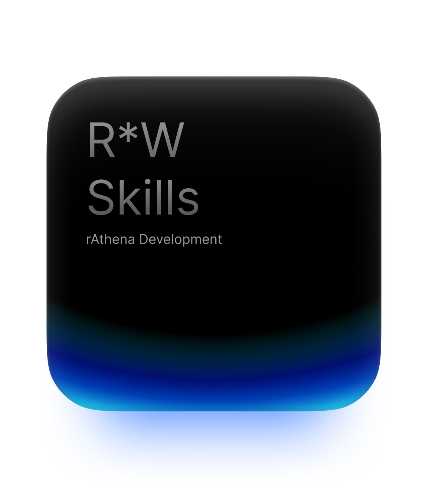

<p align="center">
  
</p>

<h1 align="center">Rune*Wright Skills</h1>

<p align="center">
  <a href="https://www.npmjs.com/package/@runewright/skills"></a>
  <a href="https://github.com/ygreat/RuneWright-Skills/blob/main/LICENSE"></a>
  <a href="http://dsc.gg/runewright"></a>
</p>

<p align="center">
  <strong>Agent skills for <a href="https://github.com/rathena/rathena">rAthena</a> Ragnarok Online server development.</strong><br>
  A designer x engineer partner for RO server owners and developers: it thinks
  like a game designer and solves problems like an engineer.
</p>

<p align="center">Created by <strong>Rune*Wright Studio by ygreat</strong>.</p>

## What it is

A collection of focused skills for AI coding agents (Claude Code, Codex,
Cursor, Gemini CLI, Copilot and others). Each skill does one job, asks for the
details it needs once, checks your own rAthena checkout as the source of truth,
and tells you early what is and is not possible.

- **Project agnostic.** Skills adapt to your server through a project profile
  (mechanics, packetver, rates, caps, conventions).
- **rAthena is the source of truth.** Your local checkout first, upstream
  second ([truth order](https://github.com/ygreat/RuneWright-Skills/blob/main/skills/runewright-shared/truth-order.md)).
- **Honest about limits.** Every request is classified by
  [feasibility layer](https://github.com/ygreat/RuneWright-Skills/blob/main/skills/runewright-shared/feasibility.md),
  from script-only (L1) to client-binary-only (L5).
- **Friendly to newcomers.** `ro-create` takes you from nothing to a running
  local server, with a short tutorial of the RO dev workflow.

## Install

Requires Node.js 18 or newer.

```sh
npx @runewright/skills install
```

The installer detects your agents (or asks) and copies the skills to the right
place for each, project-local by default:

| Agent | Project folder |
| --- | --- |
| Claude Code | `.claude/skills/` |
| Codex | `.agents/skills/` |
| Cursor | `.cursor/skills/` |
| Gemini CLI | `.gemini/skills/` |
| GitHub Copilot | `.github/skills/` |

```sh
npx @runewright/skills install --agent claude,codex   # pick agents
npx @runewright/skills install --global               # your home folder
npx @runewright/skills install --dry-run              # preview only
npx @runewright/skills list                           # show bundled skills
npx @runewright/skills update                         # refresh installed skills
npx @runewright/skills uninstall                      # remove what it installed
npx @runewright/skills doctor                         # check install health
```

The installer only updates or removes folders it created; it never overwrites
a skill folder it did not install unless you pass `--force`. Restart your
agent after installing.

## Quick start

1. Install the skills in your project folder.
2. New to RO servers? Ask your agent: *"Create a new RO server project here."*
   (`ro-create`).
3. Already have a rAthena checkout? Ask: *"Set up Runewright for this
   project."* (`runewright-setup`). It writes `.runewright/profile.md`, which
   every other skill reads first.
4. Then just work: *"Add a healer NPC in Prontera"*, *"Is this boss too
   strong?"*, *"How does the exp rate get applied?"*

## Skills

| Category | Skills |
| --- | --- |
| Setup | `runewright-setup`, `ro-create`, `ro-upgrade`, `ro-troubleshoot` |
| Concepting | `ro-writing`, `ro-balancing`, `ro-economy`, `ro-questdesign`, `ro-spec` |
| Engineering | `runewright-explain`, `ro-create-npc`, `ro-create-item`, `ro-create-mob`, `ro-create-quest`, `ro-db-edit`, `ro-source-modification`, `ro-client-files`, `ro-testing`, `ro-git` |
| Server | `ro-serverops`, `ro-deployplan` |

Run `npx @runewright/skills list` for one-line descriptions.

## How it works

- Skills are plain Markdown (`SKILL.md`) with a trigger-rich description, so
  agents load them when your request matches.
- Shared references (principles, truth order, project profile schema,
  feasibility layers, client compatibility, gotchas) live in
  `skills/runewright-shared/` and are installed alongside the skills.
- Skills never invent IDs, constants or formulas; they read your checkout and
  cite the files.

## Platforms

Windows first for local development (client and tooling). Linux for
deployment and VPS setup. English is the primary language, with a translation
path for users who need it.

## Not affiliated

Rune*Wright Skills is an independent community project. It is not affiliated
with Gravity Co., Ltd., Lee Myoungjin, or the rAthena development team.
"Ragnarok Online" is a trademark of its respective owners.

## Contributing

Issues and pull requests are welcome. See
[CONTRIBUTING.md](https://github.com/ygreat/RuneWright-Skills/blob/main/CONTRIBUTING.md).

## Community

Join the Discord: [dsc.gg/runewright](http://dsc.gg/runewright)

## License

[MIT](https://github.com/ygreat/RuneWright-Skills/blob/main/LICENSE) © 2026 Rune\*Wright Studio by ygreat.

rAthena is licensed under GPL-3.0. This repository references it and does not
redistribute its code or documentation.
